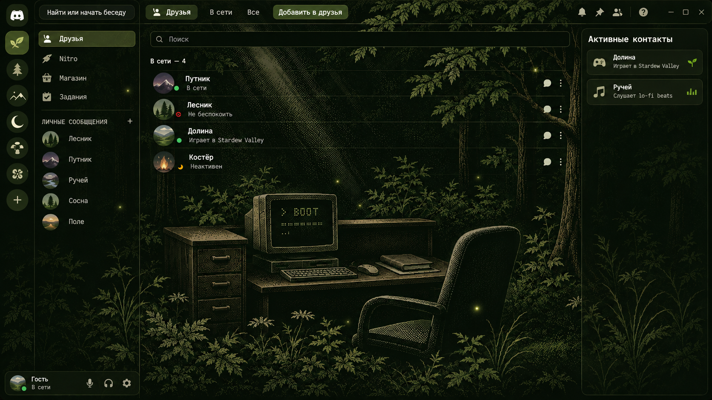
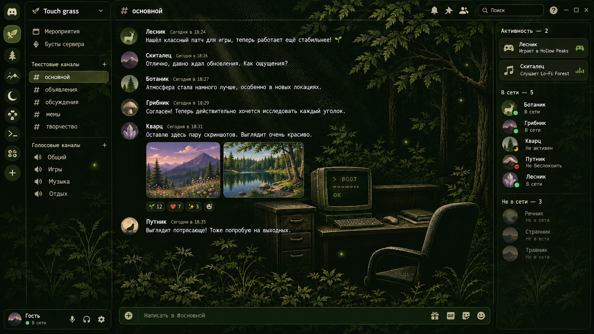

# Touch grass

**A quiet corner of Discord, reclaimed by the forest.**  
**Тихий уголок Discord, который природа забрала обратно.**

[English](#english) · [Русский](#русский)

## Preview / Предпросмотр

### Friends view / Экран друзей

### Server view / Экран сервера

---

## English

### About

**Touch grass** is a dark, forest-inspired theme for [BetterDiscord](https://betterdiscord.app/). It combines deep black-green tones, muted olive accents, translucent interface layers, and a dithered woodland illustration with a retro CRT computer hidden in the scene.

The theme is designed to make Discord feel quieter, softer, and more atmospheric while keeping the interface readable and familiar.

### Preview

The screenshots above show two main use cases of the theme:

- **Friends view** — a clean home/friends screen with the forest artwork fully visible behind the interface.
- **Server view** — a channel/chat layout preview that shows how the theme looks inside a real server with messages, sidebars, and embedded content.

All preview screenshots are anonymized mockups created to showcase the theme without personal information.

### Design

- **Forest palette:** Near-black surfaces, mossy greens, and muted olive highlights.
- **Dithered scenery:** A textured woodland background with a retro desk-and-CRT centerpiece.
- **Subtle transparency:** Interface panels stay dark, but still allow the background artwork to breathe.
- **Readable contrast:** Text remains bright and legible against the darker layers.
- **Retro terminal mood:** The CRT monitor and monochrome styling give the theme a nostalgic, terminal-like atmosphere.

### Installation

1. Install [BetterDiscord](https://betterdiscord.app/) if you haven't already.
2. Download the `.theme.css` file from this repository.
3. Open Discord and go to **User Settings → BetterDiscord → Themes**.
4. Click **Open Themes Folder** and move the `.theme.css` file there.
5. Return to the **Themes** page and enable **Touch grass**.

### Notes

- Appearance may vary depending on Discord updates, resolution, scaling, and other installed themes or plugins.
- If Discord changes its internal layout or class names, the theme may need to be updated.
- Preview screenshots are for presentation purposes and may not reflect every plugin, language, or client configuration.

### Credits

- **Theme / CSS:** *Washed*
- **Background artwork / concept:** *Add artist or source here, if applicable*

If the background artwork is based on third-party work, make sure you have permission to use and redistribute it, and provide proper attribution.

---

## Русский

### О теме

**Touch grass** — тёмная тема для [BetterDiscord](https://betterdiscord.app/), вдохновлённая лесной атмосферой. Она сочетает почти чёрные и приглушённые зелёные оттенки, полупрозрачные элементы интерфейса, иллюстрацию леса в технике дизеринга и ретро-CRT компьютер, спрятанный внутри сцены.

Тема сделана так, чтобы Discord ощущался спокойнее, мягче и атмосфернее, при этом интерфейс оставался читаемым и привычным.

### Предпросмотр

Скриншоты выше показывают два основных варианта использования темы:

- **Экран друзей** — чистый домашний экран / раздел друзей, где лесная иллюстрация хорошо видна за интерфейсом.
- **Экран сервера** — пример оформления канала и чата внутри сервера, включая сообщения, боковые панели и встроенные превью контента.

Все превью анонимизированы и сделаны как демонстрационные макеты без личной информации.

### Особенности оформления

- **Лесная палитра:** Почти чёрные поверхности, мшисто-зелёные оттенки и сдержанные оливковые акценты.
- **Дизеринг:** Текстурированный лесной фон с ретро-столом и CRT-монитором в центре композиции.
- **Лёгкая прозрачность:** Панели интерфейса остаются тёмными, но позволяют фону «дышать».
- **Хорошая читаемость:** Текст сохраняет достаточный контраст на тёмных слоях.
- **Ретро-терминальная атмосфера:** CRT-монитор и монохромное настроение добавляют теме ностальгичную терминальную эстетику.

### Установка

1. Установите [BetterDiscord](https://betterdiscord.app/), если он ещё не установлен.
2. Скачайте из этого репозитория файл `.theme.css`.
3. Откройте Discord и перейдите в **Настройки пользователя → BetterDiscord → Темы**.
4. Нажмите **Открыть папку тем** (*Open Themes Folder*) и переместите туда файл `.theme.css`.
5. Вернитесь в раздел **Темы** и включите **Touch grass**.

### Примечания

- Внешний вид может немного отличаться в зависимости от обновлений Discord, разрешения, масштабирования интерфейса и других установленных тем или плагинов.
- Если Discord изменит внутреннюю структуру интерфейса или названия классов, тему может потребоваться обновить.
- Превью в README сделаны для демонстрации и могут не отражать каждую возможную конфигурацию клиента, языка или плагинов.

### Авторы

- **Тема / CSS:** *Washed*
- **Фоновая иллюстрация / концепт:** *Укажите автора или источник, если применимо*

Если фоновая иллюстрация основана на сторонней работе, убедитесь, что у вас есть право на её использование и распространение, и обязательно укажите авторство.

---

*An independent BetterDiscord theme. Not affiliated with Discord or BetterDiscord.*  
*Независимая тема для BetterDiscord. Не связана с Discord или BetterDiscord.*
